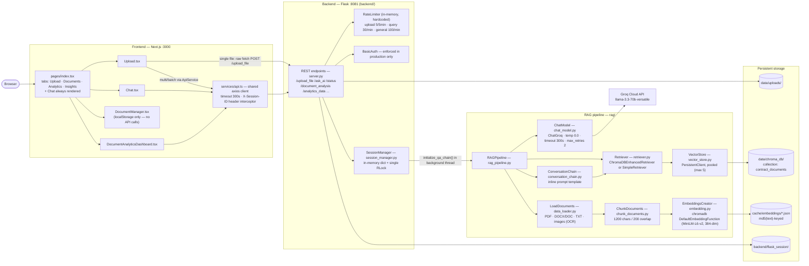
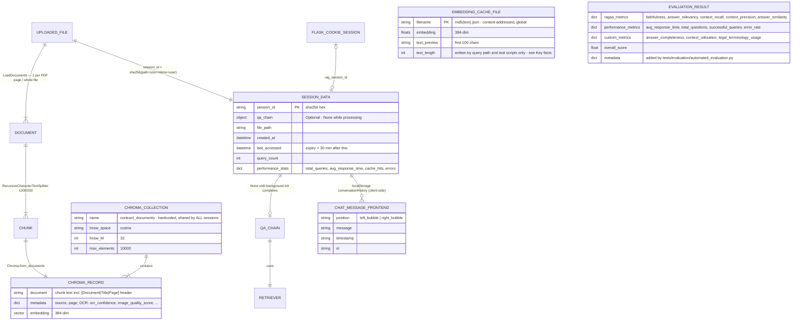
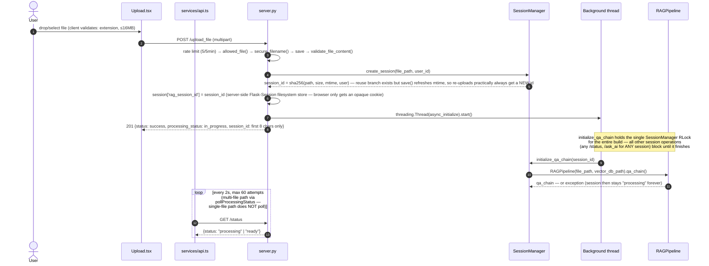
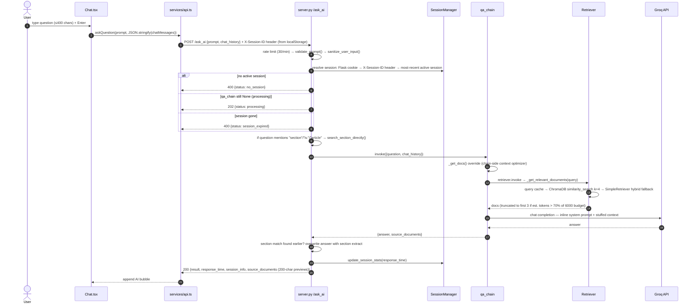
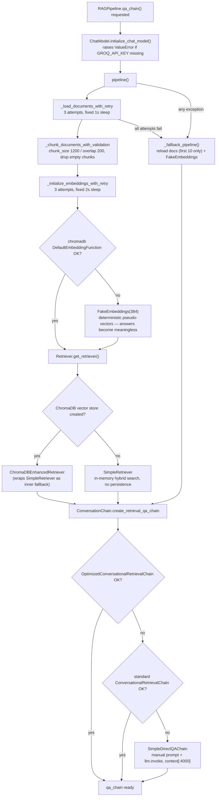
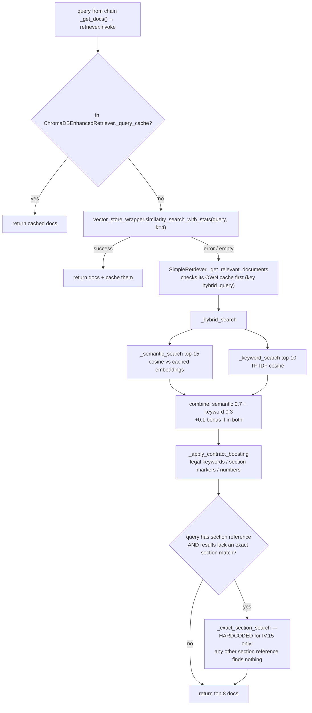
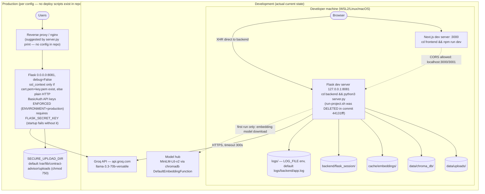
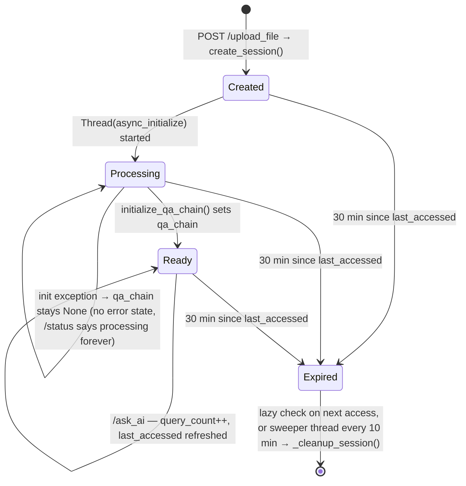
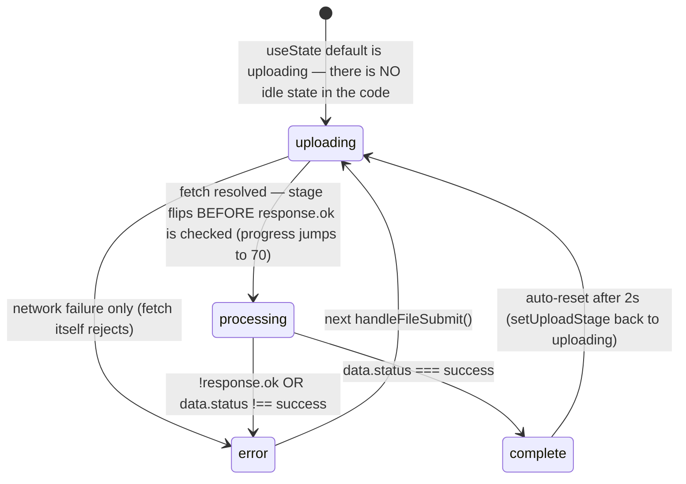

# System Diagrams

Code-grounded diagrams for the High-Precision Contract Advisor RAG system.
**Source of truth is the source code** — every diagram below was traced from the files/lines cited under it, not from prose documentation. Where older docs disagree with the code, the code wins (see [Appendix: code vs docs discrepancies](#appendix-code-vs-docs-discrepancies)).

All diagrams are Mermaid and render natively on GitHub, GitLab, and VS Code (with the Mermaid extension).

**Convention:** if a PR changes any file cited under a diagram, update that diagram in the same PR.

**Reading order**

| Goal | Diagrams |
|---|---|
| First-time understanding | [1. Architecture](#1-architecture) → [2. Data model (ERD)](#2-data-model-erd) → [3. Sequences](#3-sequence-diagrams) |
| Production / debugging | [4. Activity flows](#4-activity--flow-diagrams) → [5. Deployment](#5-deployment) → [6. State machines](#6-state-machines) |

---

## 1. Architecture

Three-tier: Next.js frontend → Flask backend → LangChain RAG pipeline, with Groq as the only wired LLM provider.

**Traced from:** `frontend/src/pages/index.tsx:100-203`, `frontend/src/services/api.ts:4-31`, `frontend/src/components/Upload.tsx:512`, `backend/server.py` (routes 1015-2071, RateLimiter 524-601, BasicAuth 604-681), `backend/session_manager.py:52-59`, `rag/rag_pipeline.py:204-218`, `rag/chat_model.py:18-24`, `rag/vector_store.py:11-66`, `rag/embedding.py:54-71`.

Notes that surprise newcomers:

- `DocumentManager.tsx` (Documents tab) never calls the backend — it reads/writes `localStorage['uploadedDocuments']` only.
- The single-file upload path in `Upload.tsx` bypasses the shared axios client (raw `fetch`), so no `X-Session-ID` header is sent on that path.
- There is **no Ollama fallback in the wired application** — `grep -i ollama rag/*.py` returns nothing; Groq is the only LLM path. (The only Ollama code left in the repo is `backend/simple_server.py`, an orphaned standalone Flask app referenced by nothing else.)

---

## 2. Data model (ERD)

There is no relational database. "Entities" are the in-memory dataclasses, cache files, and ChromaDB records the system actually persists.

**Traced from:** `backend/session_manager.py:28-46,296-310`, `backend/server.py:719-726,1079`, `rag/vector_store.py:88-162`, `rag/embedding.py:25-52`, `rag/chunk_documents.py:46-56`, `frontend/src/types/api.ts:145-151`, `rag/evaluation/rag_evaluator.py:38-73`, `tests/evaluation/automated_evaluation.py:186-198`.

Key facts:

- **One shared ChromaDB collection** (`contract_documents`) for all sessions — there is no per-session vector isolation (`rag/retriever.py:488`).
- The embedding cache (`cache/embeddings/*.json`) is content-addressed and global, but **the production upload path never writes it**: `Chroma.from_documents` calls `EmbeddingsCreator.embed_documents`, which dispatches to the model's own `embed_documents`/`__call__` before ever reaching the cached branch (`rag/embedding.py:73-85`). Cache files are written only by query-time `embed_query_cached` (`rag/retriever.py:189-190`) and by test scripts (`tests/evaluation/test_rag_integration.py`).
- `SessionData` lives only in memory — a backend restart loses all sessions (uploaded files and ChromaDB records survive).
- **Schema mismatch (known bug):** the frontend sends `chat_history` as a JSON *string* of `{position, message}` objects; the backend passes it through unparsed, while `rag/conversation_chain.py:228-233`'s fallback path expects a *list* of `{type: 'human'|'ai', content}` (`frontend/src/components/Chat.tsx:239`, `backend/server.py:1774,1788`).

---

## 3. Sequence diagrams

### 3.1 Upload → background processing → ready

Upload returns **201 immediately**; the QA chain is built in a background thread. Clients discover readiness by polling `GET /status`.

**Traced from:** `backend/server.py:1019-1138` (upload), `1086-1116` (async_initialize) + `1118-1122` (thread spawn), `1140-1174` (/status), `backend/session_manager.py:62-148,296-310`, `frontend/src/services/api.ts:277-317` (pollProcessingStatus), `frontend/src/components/Upload.tsx:426-596`.

### 3.2 Ask AI (query with chat history)

**Traced from:** `backend/server.py:1706-1843`, `frontend/src/components/Chat.tsx:176-313`, `frontend/src/services/api.ts:169-174`, `rag/conversation_chain.py:78-160`, `rag/retriever.py:533-580`.

---

## 4. Activity / flow diagrams

### 4.1 Pipeline construction — the fallback chain

The most important debugging map in the system: almost every stage has a silent fallback, so a "working" answer may have been produced by degraded components (e.g. `FakeEmbeddings`).

**Traced from:** `rag/rag_pipeline.py:25-218`, `rag/embedding.py:54-71`, `rag/retriever.py:441-513`, `rag/conversation_chain.py:78-181,184-273` (chain fallback try/except lives in `from_llm`, lines 162-181).

### 4.2 Query-time retrieval flow

**Traced from:** `rag/retriever.py:106-419,533-580` (cache check 112-118, condition 160, hardcoded patterns 396-400).

---

## 5. Deployment

**Traced from:** `backend/server.py:607-620` (BasicAuth), `682-730` (CORS/upload dir), `819` (chmod 750), `2099-2118` (startup/SSL), `backend/server.py:31-366` (ConfigValidator — the *actual* config enforcement incl. FLASK_SECRET_KEY exit), `.env.example`, `git show 44131fff^:run-project.sh` (deleted file), `setup-project.sh:75-140`. Note: `backend/config.py`'s class hierarchy is **never imported by server.py** — it is a parallel, unwired config system.

Operational facts:

- **`run-project.sh` no longer exists** (deleted in commit `44131fff`); start services manually: backend first, then frontend.
- Dev CORS in `server.py` allows ports 3000 and 3001; `config.py`'s `get_cors_origins()` is a separate, unused implementation.
- In production without cert files, the server **starts on plain HTTP on 0.0.0.0** with only a printed warning.
- Rate limits are hardcoded in `server.py:529-533`; the `RATE_LIMIT_*` env vars are read only to print warnings, never applied.

---

## 6. State machines

### 6.1 Backend session lifecycle (`SessionManager`)

**Traced from:** `backend/session_manager.py:62-165,280-354`, `backend/server.py:1086-1122,1140-1174`.

Debugging notes:

- Timeout values are the **hardcoded constructor defaults** (30 min / 10 min): the singleton is built as `SessionManager()` with no args (`session_manager.py:358`) — the `SESSION_TIMEOUT_MINUTES` env var only affects the Flask cookie config, not `SessionManager`.
- A failed initialization is indistinguishable from a slow one via the API. Check backend logs, not `/status`.
- Session-id reuse (`session_manager.py:70-75`) almost never triggers in practice: `session_id = sha256(path+size+mtime+user)`, but `upload_file()` calls `file.save()` **before** `create_session()` reads `os.stat()` — every upload refreshes mtime, so byte-identical re-uploads still get a new session.

### 6.2 Client-side upload stages (`Upload.tsx`)

**Traced from:** `frontend/src/components/Upload.tsx:35` (`useState<'uploading' | 'processing' | 'complete' | 'error'>('uploading')`), `426-596` (handleFileSubmit), `517-523` (stage set to `processing` before `!response.ok` check), `567-572` (2s reset back to `'uploading'`).

The stage value is only meaningful while `isUploading` is true — outside an active upload the UI simply doesn't render it, which is why the missing `idle` state never shows up visually. A non-OK HTTP response surfaces as a `processing → error` transition, not `uploading → error`, because the stage flips unconditionally as soon as `fetch` resolves.

Note: the progress bar on the single-file path is **simulated** (`setInterval` +10 every 200ms capped at 60, `Upload.tsx:505-510`), and `EnhancedProgressIndicator` runs its own random-increment simulation decoupled from real network state.

---

## Appendix: code vs docs discrepancies

Found while tracing these diagrams (2026-07). The diagrams above follow the **code**. Update this table when items are fixed.

| # | Documented claim (CLAUDE.md / README) | What the code actually does | Evidence |
|---|---|---|---|
| 1 | Chunks: 800 chars / 100 overlap | 1200 chars / 200 overlap | `rag/rag_pipeline.py:108` |
| 2 | Retry with exponential backoff | Fixed sleeps: 1s (load), 2s (embeddings) | `rag/rag_pipeline.py:99,138` |
| 3 | Ollama fallback in `rag/chat_model.py` | No Ollama code exists in `rag/` at all | `grep -i ollama rag/*.py` → 0 hits |
| 4 | Embeddings via HuggingFace `sentence-transformers` | `chromadb` `DefaultEmbeddingFunction` (same MiniLM model, different wrapper); the `HuggingFaceEmbeddings` class in `embedding.py` is never called | `rag/embedding.py:60-65,156-199` |
| 5 | `craft_prompt.py` provides prompt templates | Never imported; the live prompt is inline in `conversation_chain.py:82-108` | grep: 0 external references |
| 6 | `./run-project.sh` starts all services | File deleted in commit `44131fff`; start backend & frontend manually | `git show 44131fff^:run-project.sh` |
| 7 | Batch upload feature (`/upload_batch`) | Broken: `get_config` is called but never imported (NameError), plus `create_session()` called with a mismatched signature; `BatchRAGPipeline` also calls several methods that don't exist | `backend/server.py:1601,1657`, `rag/rag_pipeline.py:296-315` |
| 8 | `chat_history`: `[{type: "human"\|"ai", content}]` | Frontend sends a JSON **string** of `{position, message}` objects; backend forwards it unparsed | `frontend/src/components/Chat.tsx:239`, `backend/server.py:1774` |
| 9 | Rate limits configurable via env | Hardcoded in `RateLimiter.__init__`; `RATE_LIMIT_*` env vars only produce startup warnings | `backend/server.py:529-533` |
| 10 | Session timeout configurable via `SESSION_TIMEOUT_MINUTES` | `SessionManager()` uses hardcoded 30-min default; env var affects only the Flask cookie config | `backend/session_manager.py:51,358` |
| 11 | Per-session document isolation (implied) | All sessions share one ChromaDB collection `contract_documents` | `rag/retriever.py:488` |
| 12 | — | `OptimizedConversationalRetrievalChain` is defined twice identically; the second definition silently wins | `rag/conversation_chain.py:134,276` |
| 13 | `backend/config.py` is the configuration system | `config.py`'s class hierarchy is never imported by `server.py`; the real config enforcement is `server.py`'s own `ConfigValidator` (lines 31-366) | repo-wide grep: no imports of `config` outside `config.py` |
| 14 | Embedding cache populated during document processing | Production uploads never write `cache/embeddings/*.json` — `embed_documents` dispatches to the model before reaching the cached branch; only query-time `embed_query_cached` and test scripts write cache files | `rag/embedding.py:73-85`, `rag/retriever.py:189-190` |
| 15 | Same file re-uploaded ⇒ session reused | `file.save()` refreshes mtime before `create_session()` hashes it, so re-uploads practically always create a new session | `backend/server.py:1055,1075`, `backend/session_manager.py:296-310` |
